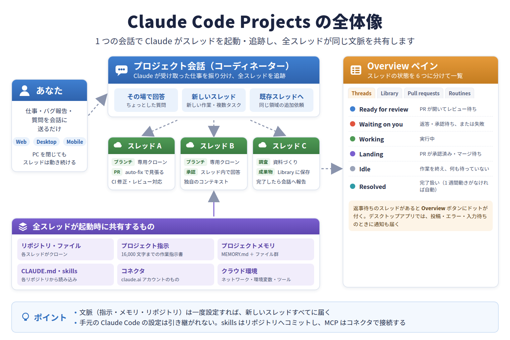
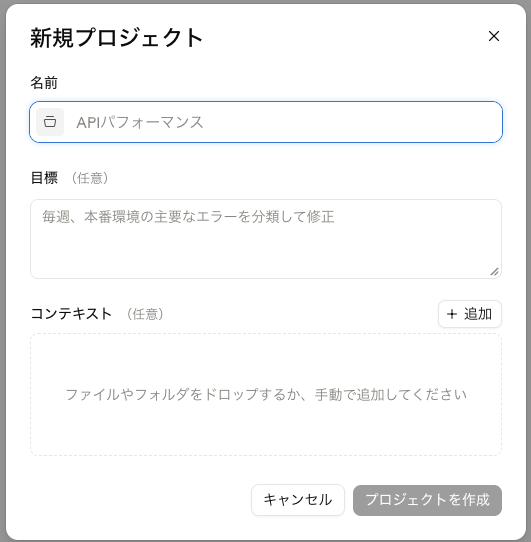
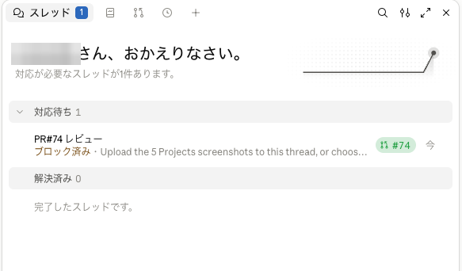
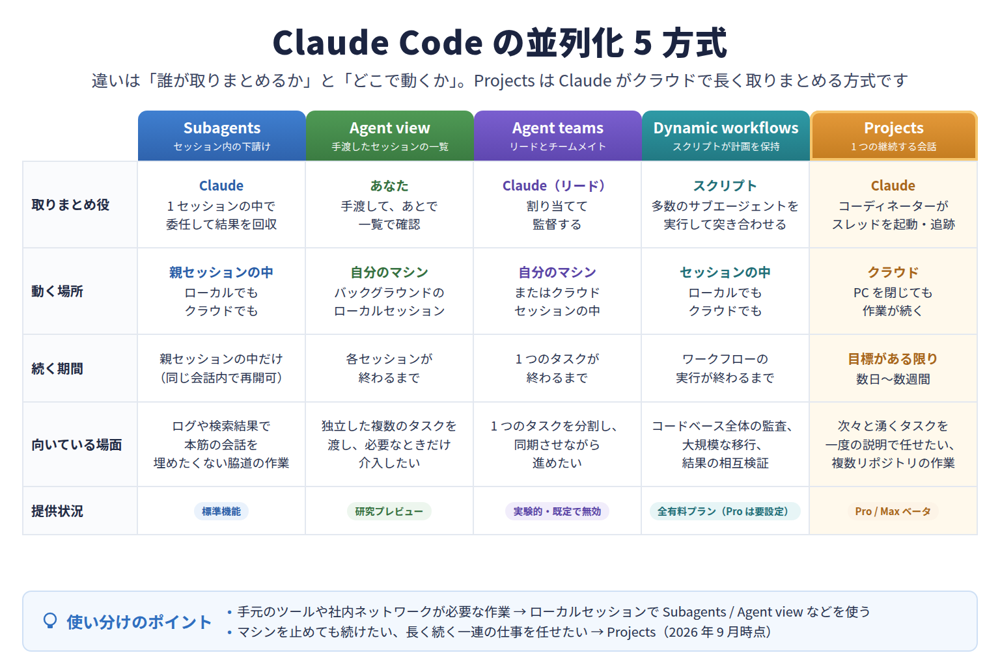

# Claude Code Projects：複数の作業の「取りまとめ」をClaudeに任せる

## はじめに

前回は、AIエージェントの作業場所をクラウドの隔離環境に移す「クラウド開発環境」を紹介しました。クラウドで動かせるようになると、PCを閉じても作業が続き、複数のタスクを同時に走らせられます。

ところが、同時に走らせるセッションが増えるほど、別の手間が増えていきます。セッションを1本ずつ起動し、それぞれに同じ背景説明を書き、どれが終わったか、どれが返事を待っているかを見て回る。この「**取りまとめ**」の仕事は、すべて自分に残ったままです。

本記事では、この取りまとめをClaudeに任せられるClaude Codeの新機能 **Projects** を紹介します。

> 本記事の内容は2026年10月時点のものです。Projectsはパブリックベータとして、Pro / Maxプランのアカウントから段階的に提供されています。Team / Enterpriseプランは未対応です。claude.ai/codeやデスクトップアプリのCodeタブのサイドバーに「Projects」が表示されていなければ、まだ自分のアカウントには届いていません。

## Projectsとは

Projectsは、**1本の続く会話の中で、Claudeが複数の作業セッションを起動・追跡してくれる**機能です。

プロジェクトの会話に仕事を投げると、Claudeが**コーディネーター**（取りまとめ役）となり、タスクごとに**スレッド**と呼ばれる作業セッションを起動します。スレッドは原則としてクラウドセッションとして並列に動くので、PCを閉じても作業は続きます。

プロジェクトは、次の4つの要素でできています。

- プロジェクト会話：長く続く1本の会話。Claudeが仕事を「その場で答える」「新しいスレッドにする」「既存のスレッドに回す」に振り分けます
- スレッド：実際に作業するクラウドセッション。自分専用のブランチを持ち、必要に応じてPR（プルリクエスト）を開いて、終わると会話に報告します
- 共有される文脈：リポジトリ、プロジェクト指示、プロジェクトメモリ、コネクタ、クラウド環境は全スレッドで共有されます
- Overviewペイン：全スレッドの状態を一覧できる画面です



ポイントは、**一度伝えたルールや決定事項が、これから起動するスレッドすべてに届く**ことです。毎回同じ説明を書き直す必要がなくなります。

なお、スレッドは自分のPCにあるClaude Codeの設定（手元だけに入れたskillsやMCPサーバーなど）を引き継ぎません。必要なものはリポジトリにコミットするか、claude.aiのコネクタとして接続しておきましょう。

## サブエージェントとの違い

「Claudeが作業を分担させる」という点では、以前の記事で紹介したサブエージェントと似ています。しかし、単位も寿命もまったく別物です。

サブエージェントは、**1つのセッションの中で働く下請け**です。親セッションが終わればそれまでで、成果は親への要約として返ってきます。

一方、Projectsのスレッドは**独立したクラウドセッション**です。プロジェクトが続く限り残り、後から追加の指示も送れます。成果はPRやブランチ、ファイルとして残ります。

目安としては、1回の作業の中で調べものを切り出したいならサブエージェント、**数日から数週間にわたって次々とタスクが生まれる目標**があるならProjects、と考えると分かりやすいです。

## どんな仕事に向いているか

公式ドキュメントでは、次のような仕事が典型例として挙げられています。

- 複数リポジトリにまたがる1つの目標（例：全サービスのlint設定を揃える）
- 継続的にタスクが湧く領域（例：1つのサービスのバグ報告を届くたびに渡す）
- 1セッションに収まらない構築や移行（例：仕様書の内容を部分ごとに実装する）
- コード以外のドキュメント作業（例：資料をアップロードして質問を重ねる）

逆に、1回で終わる単発の作業なら、普通のクラウドセッションを1本起動するほうが手軽です。定期実行だけが目的ならRoutineが向いています。

## プロジェクトを作ってみよう

### 事前準備

コードを扱う場合は、次の3点を確認しておきます。

- コードが **github.com** にあること（GitLabやBitbucketは不可）
- 接続したGitHubアカウントにpush権限があること
- **Claude GitHub App** がリポジトリにインストールされていること

特に注意したいのが3点目です。ターミナルの **/web-setup** でGitHubを接続しただけでは、プロジェクトのスレッドには足りません。Claude GitHub Appのインストールが必須です。

### 作成手順

サイドバーの **Projects** から **New project** を選ぶと、ダイアログが開きます。



入力するのは次の3つです。

- Name：プロジェクトの名前（必須）
- Goal：目指すことを1行で。Claudeはこれに向けて動きます
- Context：対象のGitHubリポジトリや、読ませたいファイル・フォルダ

リポジトリは関係しそうなものを全部入れるのではなく、**ほとんどのタスクが触る1〜2個に絞る**のがコツです。

すでに作業中のクラウドセッションがある場合は、セッションのメニューから **Continue as project** を選ぶと、そのセッションを元にプロジェクトを作れます。

## 仕事を投げて結果を受け取る

仕事はすべてプロジェクト会話に送ります。1件ずつでも、まとめてでも、思いついたメモでも構いません。ちょっとした質問ならClaudeがその場で答え、作業が必要なものはスレッドを起動して、そのことを会話で伝えてくれます。

### PRの扱い

コードを変更するスレッドは、特に指示がなければデフォルトブランチから新しいブランチを切って作業します。PRは頼まれたときに開き、バグ修正のような具体的な変更なら自分から開くこともあります。

PRを開いたスレッドは、そのPRを見張り続けます。CIが落ちれば修正をpushし、レビューコメントにも対応し、レビューできる状態になったら知らせてくれます。

### Overviewペインで状態を確認する

Overviewペインでは、スレッドが「レビュー待ち」「対応待ち」「実行中」「解決済み」などの状態ごとに分かれて表示されます。



注意したいのは、**スレッドの承認待ちには、スレッドの中で答える必要がある**ことです。プロジェクト会話で「進めて」と言っても届かないので、「対応待ち」からスレッドを開いて返答しましょう。

## 文脈を持たせる3つの置き場所

一度設定すれば全スレッドに届く「常設の文脈」は、次のように使い分けます。

- リポジトリのビルド方法やコーディング規約：リポジトリの **CLAUDE.md**
- このプロジェクトで決まったことや分かった落とし穴：**プロジェクトメモリ**
- 全スレッドに毎回厳密に守らせたいルール：**プロジェクト指示**

プロジェクトメモリは、会話やスレッドで「覚えて」と頼むだけでClaudeが保存してくれます。スレッドの間違いを正したときは、その訂正も「覚えて」と伝えておくと、以降のスレッドが最初から知っている状態になります。

プロジェクト指示には、公式ドキュメントのおすすめに沿って、次のような内容を書いておくと安定します。

```text
このプロジェクトは、payments-api リポジトリで決済 API の応答速度を改善するためのものです。

- main からブランチを切り、スレッドごとに draft PR を 1 つ開くこと。
- 完了と言う前に make test と make lint を実行し、結果を最後のメッセージに貼ること。
- 必要なものに届かない場合は、何が足りないかを書いて止まること。推測で代用しない。
- マージ、force push、CI 設定の変更は、事前に私に確認すること。
```

## 料金と使いすぎへの注意

プロジェクトの利用は、他のClaude Codeセッションと**同じプランの上限**から消費されます。複数のスレッドが同時に動くため、単一のセッションより速く上限に近づきます。

さらに、スレッドが上限に達すると、**自動で待機し、枠がリセットされたら作業を再開します**。放置していた作業が、次の利用枠を黙って使い始めるということです。止めたいときは、スレッドの停止ボタンか、プロジェクト設定の一時停止を使いましょう。

また、新規プロジェクトは既定でスレッドに大きなモデル（Opus）が設定されています。最初は次のように進めるのがおすすめです。

- まず小さな仕事を1本だけ試し、報告の仕方とブランチ上の作業を確認する
- 必要に応じてモデルやeffortを下げる
- 会話で「スレッドを始める前に提案して」「同時に動かすのは2本まで」と頼む

なお、こうした会話での依頼はClaudeが守ろうとする「好み」であって、厳密な設定ではありません。必ず守らせたいルールはプロジェクト指示に書きましょう。

## 他の並列化機能との使い分け

Claude Codeには、複数の作業を同時に進める方式がいくつかあります。違いは「**誰が取りまとめるか**」と「**どこで動くか**」です。



- Subagents：1セッションの中でClaudeが委任し、結果を回収する
- Agent view：自分が手元のマシンで複数のタスクを渡し、一覧で確認する
- Agent teams：1つのタスクをリード役のClaudeがチームで分担する
- Dynamic workflows：スクリプトが計画を持ち、多数のサブエージェントを動かす
- Projects：コーディネーターのClaudeが、クラウドで長期間にわたる多数のタスクを取りまとめる

「数日から数週間続く目標があり、一度説明したら任せておきたい」というときは、Projectsが最も向いています。

UIの名称や上限値は今後変わる可能性があります。利用時は[Claude Code Projectsの公式ドキュメント](https://code.claude.com/docs/en/claude-projects)で最新情報を確認してください。

## まとめ

要点を3つにまとめます。

- **Projects** は、1本の会話でClaudeがコーディネーターとなり、並列のスレッドを起動・追跡してくれる機能です
- スレッドはリポジトリ・プロジェクト指示・プロジェクトメモリなどを共有するため、**一度伝えたことが全スレッドに届きます**
- 単一セッションより速くプランを消費するので、**まず小さく1本試し、同時本数とモデルを絞ってから広げる**のが安全です

次のアクションとして、普段から継続的に手を入れているリポジトリを1つ選び、小さなプロジェクトを作ってみてください。複数の作業の「取りまとめ」から解放される感覚を体験できるはずです。

---

## プログラミングイベントのご案内
毎月数回、AIを活用したプログラミングを学べるオンライン講座を開催しております。直接学びたい方はぜひご参加ください。
申し込みフォームは[こちら](https://docs.google.com/forms/d/e/1FAIpQLScCLBSCJvZEl7R15tCDTajcKa7INCTSOKPEXyfIEX69Q_xtEg/viewform)
過去のプログラミングイベントの紹介は[こちら](https://sinlab.future-tech-association.org/school/)

## シンギュラリティ・ラボのご案内
オンラインサロン「シンギュラリティ・ラボ」（通称シンラボ）では、GASも含めたプログラミングをはじめ、さまざまなITスキルやチーム開発について学び、実践する場を準備しております。 初心者から経験者まで、どなたでも参加可能です。
少しでも興味がございましたらお気軽にお越しください。
シンギュラリティ・ラボHPは[こちら](https://sinlab.future-tech-association.org/join/)
お問い合わせ先 sinlab-recruit@future-tech-association.org

## GASアプリ開発サービスのお知らせ
シンギュラリティ・ラボでは、GASを中心としたWebアプリ開発のご相談を受け付けております。
普段の作業のちょっとした自動化から自分やチーム専用のカスタムアプリまで、ぜひお気軽にお問い合わせください。
詳細は[こちら](https://appdev.future-tech-association.org/)
