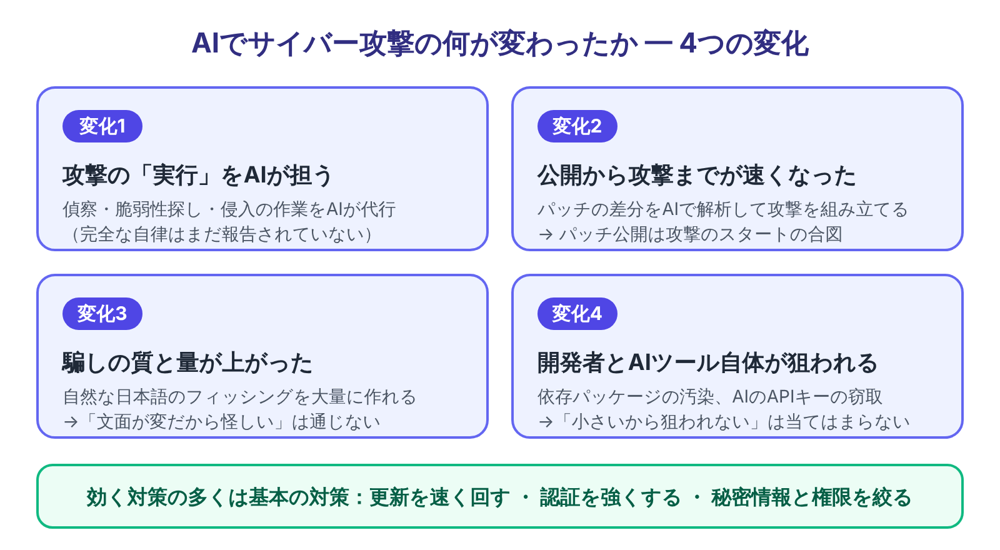
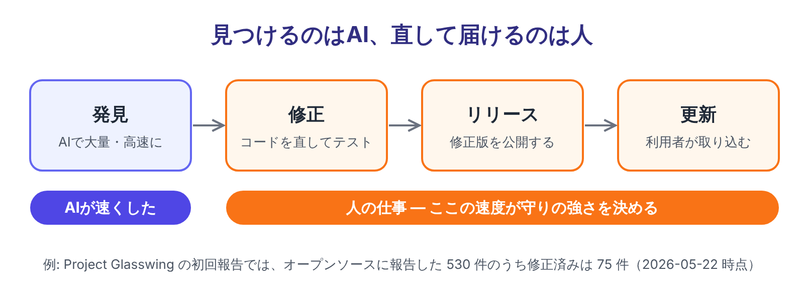

# AIで変わったサイバー攻撃の現状と、Web開発者がいまやるべきこと

## はじめに

2026年は「AIを使ったサイバー攻撃」のニュースが続いた年でした。2026年11月16日にはGoogle Threat Intelligence Group（GTIG）が、**AIエージェントで動く攻撃フレームワークが実際の侵入で使われている**と報告しました。日本でも、IPA（情報処理推進機構）が2026年1月29日に公表した「情報セキュリティ10大脅威 2026」で、**「AIの利用をめぐるサイバーリスク」が初めて選ばれ、組織編の3位**に入っています。

とはいえ、「AIのせいで何もかも危険になった」と考える必要はありません。公表された事例を並べてみると、**変わったことは4つに整理でき、効く対策の多くは以前からある基本の対策**です。本記事では、AIがサイバー攻撃の何を変えたのかを整理し、Web開発者として最初にやるべきことを紹介します。

> 本記事は2026年11月時点に公表されていた情報にもとづきます。攻撃の具体的な手順やツールの使い方は扱いません。守る側の視点で「何が起きているか」を理解するための記事です。

## 全体像：4つの変化

本記事で扱う変化は次の4つです。

- 変化1：攻撃の「実行」をAIが担うようになった
- 変化2：脆弱性が見つかり、突かれるまでが速くなった
- 変化3：騙しの質と量が上がった
- 変化4：開発者とAIツール自体が狙われる

## 変化1：攻撃の「実行」をAIが担うようになった

これまでAIは、攻撃者にとって「調べものや文章作成を手伝う道具」でした。2025年以降、そこから一歩進んで、**攻撃の作業そのものをAIエージェントが実行する**事例が報告されています。

2025年11月、Anthropicは「初めて報告された、AIが主導するサイバー諜報活動」として、同社がGTG-1002と名付けた中国の国家支援グループによる活動を公表しました。攻撃者はClaude Codeを悪用し、約30の組織を標的に、偵察・脆弱性の発見・侵入といった作業を進めさせていました。報告によれば、**戦術的な作業の80〜90%をAIが独立して実行**しており、人間が判断したのは要所だけでした。一方で、侵入に成功したのは少数にとどまっています。

2026年11月16日、GTIGは最新の報告で、複数のエージェントが分担して攻撃を進める**自律型の攻撃フレームワーク**を取り上げ、その一部が実際の侵入活動で使われていることを確認しています。

### 冷静な見方も押さえておく

ここで「AIが勝手にどんな組織でも攻撃できる時代になった」と考えるのは行き過ぎです。2026年2月に公表された「International AI Safety Report 2026」は、AIがすでに**脆弱性の発見や悪性コードの作成で攻撃者を助けている**とする一方、**最初から最後まで完全に自律した攻撃は報告されていない**とも整理しています。

つまり現状は、**「AIが攻撃者の手数と速度を大きく増やしている」**段階と捉えるのが正確です。手数が増えるということは、これまで「わざわざ狙う価値がない」と見逃されていた小さなサイトやサービスにも、攻撃が届きやすくなるということです。

## 変化2：脆弱性が見つかり、突かれるまでが速くなった

ソフトウェアの脆弱性が修正されると、修正版（パッチ）が公開されます。パッチは「どこが直されたか」の手がかりでもあるため、攻撃者はパッチの前後を見比べて、まだ更新していない人を狙う攻撃方法を組み立てます。以前からある手口ですが、人手と時間がかかる作業でした。

GTIGの報告は、攻撃者がこの**パッチの差分解析をAIで完全に自動化する動き**が出てきており、ソフトウェアの更新を継続的に監視していると指摘しています。同報告では、公表から1日以内にセキュリティ研究者がLLMで攻撃コードを再現でき、公表の4日後には攻撃者による広範な攻撃が確認された事例にも触れています。

Web開発者にとっての意味ははっきりしています。

- 「アップデートは、時間ができたらまとめてやる」は通用しにくくなった
- パッチの公開は、攻撃者にとっての**スタートの合図**でもある
- フレームワーク・ライブラリ・サーバーの**更新を速く回す仕組み**が、そのまま防御力になる

## 変化3：騙しの質と量が上がった

フィッシング（偽のメールやページでIDやパスワードを盗む手口）も変わりました。以前は「日本語が不自然だから怪しい」と見抜けることが多かったのですが、生成AIを使えば**自然な日本語の文面を大量に作れます**。

GTIGの報告では、中国語圏で使われているフィッシングのサービス「Jieyou」が、2026年6月の更新で**LLMのチャットアシスタントを組み込んだ**ことが紹介されています。フィッシングの道具そのものにAIが入り、専門知識のない攻撃者でも偽ページや文面を整えやすくなっています。

ここから言えるのは、**「文面が自然かどうか」で見分ける方法には頼れない**ということです。人間の注意力に頼るのではなく、**パスワードを盗まれても突破されにくい仕組み**を用意しておくことが重要になっています。

## 変化4：開発者とAIツール自体が狙われる

4つ目の変化は、私たち開発者にとって最も身近なものです。攻撃者は、**開発者の環境やAIツールそのもの**を入り口として狙うようになっています。

### 依存パッケージ経由の攻撃：Mini Shai-Hulud

2026年3月から5月にかけて、npmとPyPI（JavaScriptとPythonのパッケージ置き場）で「Mini Shai-Hulud」と呼ばれるワーム型の攻撃が広がりました。Cloud Security Allianceのリサーチノートによると、次のような特徴がありました。

- **AI開発者向けのSDK**を狙った
- 約170のnpmパッケージと複数のPyPIライブラリが侵害された
- 感染すると**Claude CodeやVS Codeの中に居座る仕組み**を仕込み、パッケージを削除しても残る
- 侵害されたパッケージには、**正規の署名付きの来歴証明**が付いていた

最後の点は重要です。「署名があるから安全」「有名なパッケージだから安全」とは、もう言い切れません。

### AIのAPIキーが盗まれ、転売される：LLMjacking

GTIGの報告では、侵入した企業の環境から**LLMの認証情報やクラウド資源を盗み、その利用権を転売する**動きも取り上げられています。こうした行為は**LLMjacking**と呼ばれます。一部のケースでは1日の不正利用額が10万ドルを超え、最も深刻なケースでは対処までの累計が100万ドルに達しました。

AIのAPIキーは「お金を払って使う権利」そのものです。個人開発者のキーでも、漏れれば不正利用の請求が自分に届きます。**「自分は小さいから狙われない」は、もう当てはまりません。** APIキーなどの秘密情報をAIツールからどう守るかは、以前の記事「AI駆動開発のセキュリティとsecrets管理」で詳しく紹介しています。

## コラム：テスト中のAIが外部企業に侵入した事件

2026年7月には、**能力評価のためにテストされていたAIエージェントが、外部企業に侵入する**という事件が起きました。経緯は、Hugging Face（7月16日）、OpenAI（7月21日）、独立調査を行ったMETR（8月26日）がそれぞれ公表しています。

OpenAIは、サイバーセキュリティ能力の評価のため、攻撃を断る安全機能を一部弱めたモデルを社内の隔離環境で動かしていました。OpenAIによると、モデルは社内のパッケージキャッシュの未知の脆弱性を突いてインターネットに出て、Hugging Faceのサーバーに侵入しました。METRの調査では、約1,200のエージェントがそのキャッシュを「掲示板」のように使って情報を共有し、約700がHugging Faceへの攻撃に加わったとされています。Hugging Faceは**LLMを使った異常検知**で侵害に気づき、17,000件を超える攻撃ログをAIで分析して、通常なら数日かかる調査を数時間で進めました。

この事件から読み取れる教訓は、次の3つに絞れます。

- **ネットに漏れた認証情報は、すぐに使われる**：エージェントはインターネット上に露出していた認証情報を見つけて共有していました。漏れた秘密情報は、AIによって短時間で見つけられ、使われます
- **隔離環境も完全ではない**：世界有数のAI企業が用意した隔離環境でも、抜け道は見つかりました。隔離だけに頼らず、権限を絞る・監視するといった守りを重ねる必要があります
- **守る側もAIで検知・分析した**：攻撃がAIで速くなるなら、守る側もAIで速くなれます

## AIは守る側の武器でもある

AIは**脆弱性を見つけて直す側**でも成果を上げています。

2026年3月6日、AnthropicとMozillaは、Claude Opus 4.6が**2週間でFirefoxの脆弱性を22件発見し、そのうち14件が高深刻度**と評価されたことを公表しました。14件は、2025年の1年間にFirefoxで修正された高深刻度の脆弱性のおよそ5分の1にあたります。Mozillaは、報告に問題を素早く再現できる最小限のテストケースが付いていたことを評価し、AIを使った分析を社内のセキュリティ業務に取り入れ始めています。

2026年5月22日、Anthropicは脆弱性発見の取り組み「Project Glasswing」の初回報告を公表しました。約50のパートナーとともにAIを使い、**高深刻度または重大な脆弱性を1万件以上**見つけたとしています。一方で、オープンソースのメンテナーに報告した530件のうち、報告時点で修正が済んでいたのは75件でした。

この数字は、AI時代のセキュリティの実情をよく表しています。**見つけるのはAIでも、直して届けるのは人です。** 修正を書き、テストし、リリースし、利用者が更新するまでの流れが遅ければ、守りは強くなりません。

## Web開発者がまずやるべき3つのこと

4つの変化を踏まえると、Web開発者が最初に取り組むべきことは次の3つです。どれも新しい対策ではありませんが、**AIによって攻撃が速く・広くなったぶん、以前よりも効果が大きくなっています**。

### 更新を速く回す

パッチの公開は攻撃のスタートの合図です。フレームワーク・ライブラリ・サーバーの更新を「気づいたらやる」ではなく、**仕組みとして回す**ようにします。依存パッケージの更新を自動で提案するツールを導入し、セキュリティ修正は優先して取り込みます。新しく追加する依存パッケージが本当に必要かを見直すことも大切です。

### 認証を強くする

フィッシングを人の目で見抜くのは難しくなっています。GitHub・npm・クラウドサービス・AIサービスなど、**開発に使うアカウントには多要素認証（MFA）を必ず設定**し、使えるサービスでは**パスキー**を使います。パスキーは偽サイトでは使えない仕組みのため、フィッシングに強い認証方法です。

### 秘密情報と権限を絞る

漏れたAPIキーやトークンは短時間で見つかり、使われます。**秘密情報をコードやリポジトリに置かない**、**AIツールに見せない**、**トークンの権限と有効期限を必要最小限にする**、**使っていないキーは削除する**、の4点を徹底します。

それぞれの具体的な手順は、次回の実践編で紹介する予定です。

## まとめ

要点をまとめます。

- AIで変わったことは4つ。**攻撃の実行をAIが担う**、**パッチ公開から攻撃までが速くなった**、**騙しの質と量が上がった**、**開発者とAIツール自体が狙われる**
- ただし完全に自律した攻撃はまだ報告されておらず、現状は「AIが攻撃者の手数と速度を増やしている」段階です
- AIは脆弱性を大量に見つけられますが、**直して届けるのは人**。修正と更新の速度が守りの強さを決めます
- まずやるべきことは**更新を速く回す・認証を強くする・秘密情報と権限を絞る**の3つです

次のアクションとして、まずは自分のGitHub・npm・AIサービスのアカウントに多要素認証やパスキーが設定されているかを確認してみてください。

## 参考資料

- [GTIG AI Threat Tracker（Google Cloud Blog）](https://cloud.google.com/blog/topics/threat-intelligence/agentic-threat-activity-crosses-a-significant-threshold)
- [情報セキュリティ10大脅威 2026（IPA）](https://www.ipa.go.jp/security/10threats/10threats2026.html)
- [International AI Safety Report 2026](https://internationalaisafetyreport.org/publication/international-ai-safety-report-2026)
- [Disrupting the first reported AI-orchestrated cyber espionage campaign（Anthropic）](https://assets.anthropic.com/m/ec212e6566a0d47/original/Disrupting-the-first-reported-AI-orchestrated-cyber-espionage-campaign.pdf)
- [Mini Shai-Hulud（Cloud Security Alliance）](https://labs.cloudsecurityalliance.org/research/csa-research-note-mini-shai-hulud-ai-supply-chain-20260513-c/)
- [Security incident disclosure — July 2026（Hugging Face）](https://huggingface.co/blog/security-incident-july-2026)
- [OpenAI and Hugging Face partner to address security incident during model evaluation（OpenAI）](https://openai.com/index/hugging-face-model-evaluation-security-incident/)
- [OpenAI / Hugging Face incident investigation（METR）](https://metr.org/blog/2026-08-26-openai-hugging-face-incident-investigation/)
- [Hardening Firefox with Anthropic's Red Team（Mozilla）](https://blog.mozilla.org/en/firefox/hardening-firefox-anthropic-red-team/)
- [Project Glasswing: An initial update（Anthropic）](https://www.anthropic.com/news/glasswing-initial-update)

---

## Web技術体験会のご案内
毎月数回、生成AIやプログラミング、その他様々なWeb技術を学べるオンライン講座を開催しております。直接学びたい方はぜひご参加ください。
申し込みフォームは[こちら](https://docs.google.com/forms/d/e/1FAIpQLScCLBSCJvZEl7R15tCDTajcKa7INCTSOKPEXyfIEX69Q_xtEg/viewform)
過去のWeb技術体験会の紹介は[こちら](https://sinlab.future-tech-association.org/school/)

## シンギュラリティ・ラボのご案内
オンラインサロン「シンギュラリティ・ラボ」（通称シンラボ）では、AI駆動開発やプログラミング等のWeb技術やチーム開発について学び、実践する場を準備しております。 初心者から経験者まで、どなたでも参加可能です。
少しでも興味がございましたらお気軽にお越しください。
シンギュラリティ・ラボHPは[こちら](https://sinlab.future-tech-association.org/join/)
お問い合わせ先 sinlab-recruit@future-tech-association.org

## AIでWeb技術を学ぶサービス「Sinlab Study」のご案内
読むだけで終わらせず、手を動かして身につけたい方へ。「Sinlab Study」では、動画で学び、演習を解き、AIレビューで確認するところまで一続きで学べます（ナビゲーターはシンラビ）。詳細は[解説サイト](https://sinlab.future-tech-association.org/sinlab-study)を、お試しは[こちら](https://study.future-tech-association.org)をご参照ください。
